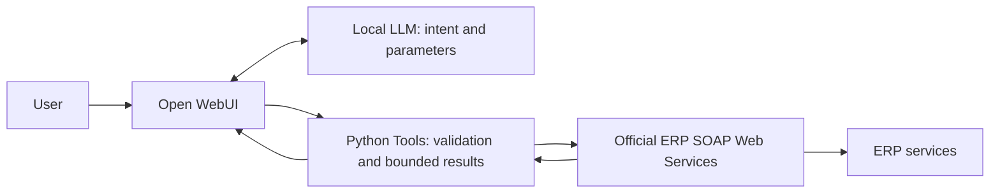

# Enterprise ERP AI Agent

**Conversational ERP Integration via Official Web Services**

A read-only enterprise POC connecting Open WebUI and a local LLM to an ERP's official SOAP Web Services. The model selects tools and extracts business parameters; a deterministic Python Tool layer validates requests, bounds results, and merges records.

**Status:** Read-only POC. Write and approval workflows are incomplete. No formal Production acceptance is claimed.

以自然語言串接 ERP 官方介接層，將查詢與資料整理交給確定性工具，而非讓模型自由產生查詢結構。這是服務層級存取的 POC；正式上線仍需驗證使用者授權及操作邊界。

## Engineering Highlights

- **18 read-only Tool functions** spanning order lookup, fulfillment tracking, inventory, and personal pending-approval queries.
- **Bounded retrieval:** customer or supplier filtering, date validation, clarification for ambiguous matches, and result limits to control context growth.
- **Deterministic record merging:** complete composite keys and application-layer lookups instead of model-generated joins or totals.
- **17/17 archived fixed tests reported passing** against a test ERP environment. This is a development record, not a public reproducible benchmark.

## Architecture

The diagram shows logical responsibilities, not an internal network topology. The Tool layer constrains business parameters and performs deterministic aggregation. Official Web Services are the integration boundary; their behavior must be validated per operation and cannot be assumed to reproduce every UI calculation.

## Evidence and Limits

| Area | Supported result | Qualification |
|---|---|---|
| Read-only tools | 18 functions documented | Function count is not a claim that every function has independent end-to-end coverage |
| Fixed test suite | Archived development record reports 17/17 | Independent test-output artifact was not retained in the handoff; not rerun here |
| Personal pending approvals | Read-only lookup and cross-consistency checks documented | Identity handling does not establish complete per-user ERP authorization |
| Write and approval actions | Exploratory work only | Incomplete; no usable write or approval capability claimed |

Current access is a service-level POC. Per-user authentication and authorization require additional validation before formal deployment. Credential handling is not represented as Production-ready. UI conversation checks were reported by the owner, without retained screenshots.

## My Contributions / AI-Assisted Engineering

**Project Owner:** defined requirements and priorities, guided architecture and solution selection, supplied business context, and reviewed results and acceptance criteria.

**Claude Code:** implemented the Tool layer, scripts, and tests; performed recorded SOAP investigation, debugging, and Open WebUI integration work. The owner did not personally write most of this code.

**Codex:** prepared this documentation from the de-identified handoff; no ERP execution or deployment was performed for this portfolio draft.

## Documentation and Reproducibility

Read the [Engineering Journey](docs/ENGINEERING_JOURNEY.md) for decisions, checks, and unresolved constraints. This repository candidate contains de-identified documentation only: no enterprise source code, query structures, credentials, or data. The original test environment is unavailable here, so the archived results cannot be reproduced from these files alone.
